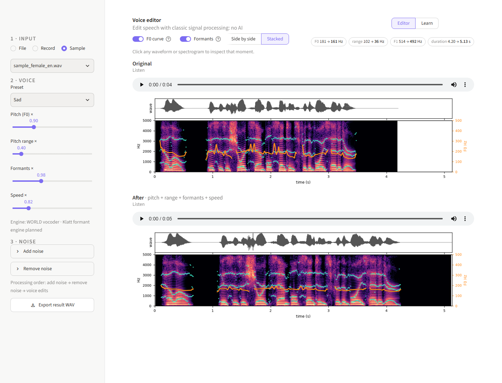

# Voice editor

A personal and teaching tool that edits speech with **classic signal processing, no AI**.
Load a file, record your voice or pick a sample, then change pitch, pitch range, formants
and speed, or add and remove background noise. See every change on waveforms and
spectrograms, click any moment to inspect it, and learn how it all works in 13 built-in
lessons.


## Quick start

You need **Python 3.11 or newer** ([python.org](https://www.python.org/downloads/)) and
**Git**. Tested on Windows 11 with Python 3.13.

**1. Get the code**

```
git clone https://github.com/IbrahimSobh/voiceeditor.git
cd voiceeditor
```

**2. Create a virtual environment and install the libraries** (a few minutes the first time)

Windows:

```
py -m venv .venv
.venv\Scripts\python -m pip install -r requirements.txt
```

macOS / Linux:

```
python3 -m venv .venv
.venv/bin/python -m pip install -r requirements.txt
```

**3. Start the app**

Windows:

```
.venv\Scripts\streamlit run app.py
```

macOS / Linux:

```
.venv/bin/streamlit run app.py
```

Your browser opens at **http://localhost:8501**. The first start takes about 30 seconds
while matplotlib builds its font cache.

**4. Try it**

1. In the sidebar, under **1 · Input**, choose **Sample** (or **Record** to use your microphone).
2. Under **2 · Voice**, pick the preset **More female** and press play on the **After** panel.
3. Under **3 · Noise**, open **Add noise**, tick it, then open **Remove noise** and tick it too.
4. Click anywhere on a spectrogram to inspect that moment.
5. Switch to **Learn** (top right) for the lessons.

**Troubleshooting**

- *Changes in the code don't show up:* stop the app with Ctrl+C and start it again.
- *`pip install` fails while building `pyworld`:* your Python version has no ready-made
  package for it. Use Python 3.11–3.13, or install a C++ compiler (on Windows, the free
  "Microsoft C++ Build Tools").
- *Port 8501 is busy:* add `--server.port 8502` to the run command.

## Features

### Edit a voice

| Control | What it changes |
|---|---|
| **Preset** | stored settings: *More female*, *More male*, *Happy*, *Sad* |
| **Pitch ×** | the F0 (vocal-fold rate), every voiced frame scaled |
| **Pitch range ×** | how lively the intonation is: flattens or widens the F0 curve around its mean |
| **Formants ×** | vocal-tract size: stretches the spectral envelope along frequency |
| **Speed ×** | duration, without changing pitch |
| **Add noise** | white, pink, brown, 50 Hz or 60 Hz hum, at a chosen SNR (measured on active speech) |
| **Remove noise** | spectral subtraction or Wiener filter, with strength, spectral floor and noise-estimate controls |

Each panel shows the waveform and the spectrogram, with the **F0 curve** (orange, scale on
the right) and the **formants F1–F3** (green dots) drawn on top. Players keep true
loudness, so *Noise alone* and *Removed part* play at their real level. Panels can sit
side by side or stacked:



### Inspect any moment

Click a waveform or spectrogram. A window opens with amplitude, level at the clicked
frequency, F0 and F1–F3 for every panel, the spectrum of that 40 ms frame (harmonics and
the WORLD envelope), and a 0.5 s clip around the click from each panel.


### Learn

The **Learn** view has 13 lessons with interactive demos, from what sound is to every
algorithm used here: digital audio, the source–filter model, spectrum and FFT,
spectrogram, pitch tracking (autocorrelation and Harvest), formants and LPC, the WORLD
vocoder (Harvest, CheapTrick, D4C), how each edit works, noise and its removal, Arabic
emphatic consonants, tools and references, and a glossary.

| Build a vowel from source × filter | Formants and the vowel chart | WORLD, decomposed |
|---|---|---|
|  |  |  |

## Listen: before and after

Each video plays the **before** sound (playhead on the left spectrogram), a short pause, then the
**after** sound (playhead on the right). Press play; turn the sound on if the player starts muted.
Below each video are the separate WAV files. All were made by [make_examples.py](make_examples.py)
and [make_videos.py](make_videos.py) with the same code as the app, from the sample sentences.

### Voice edits

#### Male → female (More female: F0 ×1.6, range ×1.1, formants ×1.17)

https://github.com/user-attachments/assets/946183b7-71a9-4330-b84e-293395c8f25c

Before: <audio controls src="docs/audio/original_male.wav"></audio> [original_male.wav](docs/audio/original_male.wav) · After: <audio controls src="docs/audio/male_to_female.wav"></audio> [male_to_female.wav](docs/audio/male_to_female.wav)

#### Female → male (More male: F0 ×0.65, range ×0.9, formants ×0.88)

https://github.com/user-attachments/assets/ada8db01-467f-4bfa-b463-3139f259f220

Before: <audio controls src="docs/audio/original_female.wav"></audio> [original_female.wav](docs/audio/original_female.wav) · After: <audio controls src="docs/audio/female_to_male.wav"></audio> [female_to_male.wav](docs/audio/female_to_male.wav)

#### Happy: higher, livelier pitch, 12 % faster

https://github.com/user-attachments/assets/3ac65e9b-a7b3-41c2-9513-8f1119fe5c6e

Before: <audio controls src="docs/audio/original_female.wav"></audio> [original_female.wav](docs/audio/original_female.wav) · After: <audio controls src="docs/audio/happy.wav"></audio> [happy.wav](docs/audio/happy.wav)

#### Sad: lower, flatter pitch, 18 % slower

https://github.com/user-attachments/assets/5fe0f318-44d3-443f-8978-54070364f25b

Before: <audio controls src="docs/audio/original_female.wav"></audio> [original_female.wav](docs/audio/original_female.wav) · After: <audio controls src="docs/audio/sad.wav"></audio> [sad.wav](docs/audio/sad.wav)

#### Slower, speed ×0.75 (same pitch)

https://github.com/user-attachments/assets/64a1e36f-1296-4786-9ba5-6242aeace9ba

Before: <audio controls src="docs/audio/original_male.wav"></audio> [original_male.wav](docs/audio/original_male.wav) · After: <audio controls src="docs/audio/slower_0.75x.wav"></audio> [slower_0.75x.wav](docs/audio/slower_0.75x.wav)

#### Faster, speed ×1.5 (same pitch)

https://github.com/user-attachments/assets/7580a49b-e90d-445e-9081-db83e9b61fb2

Before: <audio controls src="docs/audio/original_male.wav"></audio> [original_male.wav](docs/audio/original_male.wav) · After: <audio controls src="docs/audio/faster_1.5x.wav"></audio> [faster_1.5x.wav](docs/audio/faster_1.5x.wav)

### Noise

#### Add white noise at 10 dB SNR

https://github.com/user-attachments/assets/6308e847-05eb-4072-9632-62196c8abea0

Before: <audio controls src="docs/audio/original_male.wav"></audio> [original_male.wav](docs/audio/original_male.wav) · After: <audio controls src="docs/audio/noisy_white_10dB.wav"></audio> [noisy_white_10dB.wav](docs/audio/noisy_white_10dB.wav)

#### Remove it: spectral subtraction

https://github.com/user-attachments/assets/94d99712-c62f-40f9-bbbd-639a7c9a44b2

Before: <audio controls src="docs/audio/noisy_white_10dB.wav"></audio> [noisy_white_10dB.wav](docs/audio/noisy_white_10dB.wav) · After: <audio controls src="docs/audio/denoised_spectral_subtraction.wav"></audio> [denoised_spectral_subtraction.wav](docs/audio/denoised_spectral_subtraction.wav)

#### Remove it: Wiener filter

https://github.com/user-attachments/assets/495a64fb-897c-4f1b-b896-9630f1cc4cf2

Before: <audio controls src="docs/audio/noisy_white_10dB.wav"></audio> [noisy_white_10dB.wav](docs/audio/noisy_white_10dB.wav) · After: <audio controls src="docs/audio/denoised_wiener.wav"></audio> [denoised_wiener.wav](docs/audio/denoised_wiener.wav)

#### Add 50 Hz mains hum at 10 dB SNR

https://github.com/user-attachments/assets/57cd0e04-64a5-457d-9678-4f942c9a3053

Before: <audio controls src="docs/audio/original_female.wav"></audio> [original_female.wav](docs/audio/original_female.wav) · After: <audio controls src="docs/audio/hum_50Hz_10dB.wav"></audio> [hum_50Hz_10dB.wav](docs/audio/hum_50Hz_10dB.wav)

#### Remove the hum: Wiener filter, strength ×1.5

https://github.com/user-attachments/assets/12cf2f87-4ca0-4f51-93ef-9114ab75ad87

Before: <audio controls src="docs/audio/hum_50Hz_10dB.wav"></audio> [hum_50Hz_10dB.wav](docs/audio/hum_50Hz_10dB.wav) · After: <audio controls src="docs/audio/hum_removed_wiener.wav"></audio> [hum_removed_wiener.wav](docs/audio/hum_removed_wiener.wav)

Listen for the trade-off: spectral subtraction removes more noise but leaves faint
"musical noise" (random beeps); the Wiener filter sounds smoother but keeps a little more
hiss.

## Settings in the web address

Settings can also be given in the address, which is handy for demos, for example:

- `http://localhost:8501/?sample=sample_male_en.wav&preset=More+female&add=White&snr=15&remove=Wiener+filter`
- `http://localhost:8501/?sample=sample_male_en.wav&click=1.62,1200` (opens the inspection window)
- `http://localhost:8501/?view=learn&lesson=7`

Parameters: `sample`, `preset`, `add` (noise type), `snr`, `remove` (method), `click`
(time in s, frequency in Hz), `layout=stacked`, `view=learn`, `lesson` (1–13).

## Checks and regenerating the docs

```
.venv\Scripts\python check_pipeline.py
```

Measures that each edit and noise tool does what it claims (pitch ratio, range ratio,
formant shift, duration, SNR accuracy, noise removal, click-to-data accuracy).

```
.venv\Scripts\python make_examples.py
```

Rebuilds `docs/audio` and the example spectrogram pictures. Then `make_videos.py` rebuilds `docs/video`
(it needs ffmpeg: `.venv\Scripts\python -m pip install imageio-ffmpeg`);
GitHub only plays videos uploaded through its web editor, so new videos must be re-uploaded
(drag them into any comment box on GitHub, copy the `user-attachments` links into this README).

```
.venv\Scripts\streamlit run app.py --server.port 8503
.venv\Scripts\python make_screenshots.py 8503
```

Rebuilds the screenshots in `docs/img` with a headless Chrome or Edge (a throwaway
profile, not yours).

## How it works

Processing order: input → add noise → remove noise → voice edits. When no voice edit is
active, WORLD is skipped, so the noise result is heard exactly.

| Step | Tool | File |
|---|---|---|
| Load, mono, resample to 16 kHz | soundfile, scipy | `voiceeditor/audio_io.py` |
| Add noise at a chosen SNR | numpy | `voiceeditor/noise.py` |
| Remove noise (spectral subtraction or Wiener filter) | scipy STFT | `voiceeditor/noise.py` |
| Split speech into F0, spectral envelope, aperiodicity | WORLD (pyworld) | `voiceeditor/analysis.py` |
| Formant tracks F1–F3 for display | Praat (parselmouth) | `voiceeditor/analysis.py` |
| Edits and presets | numpy | `voiceeditor/edits.py` |
| Plots, click-to-data conversion | matplotlib | `voiceeditor/plots.py` |
| Clickable images | streamlit-image-coordinates | `app.py` |
| User interface | Streamlit | `app.py` |
| Lessons and their demos | Streamlit, matplotlib | `voiceeditor/lessons.py` |

The Learn view explains every step in detail.

## Roadmap

- Version 2: Klatt formant engine, with a view comparing the same edit through WORLD and Klatt.
- Later: loudness and brightness controls for emotion.

The `samples` folder holds two English sentences made with Windows' built-in voices
(Microsoft David and Zira) and a short Arabic recording of a male voice.
