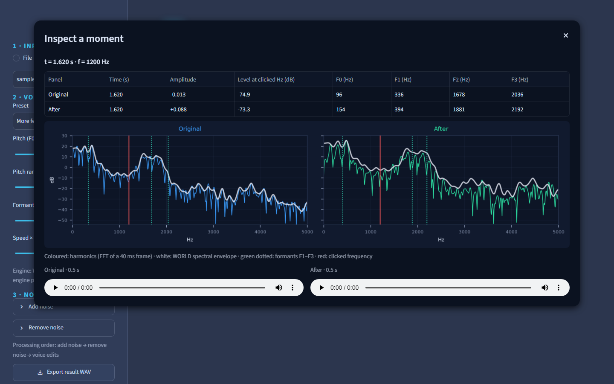
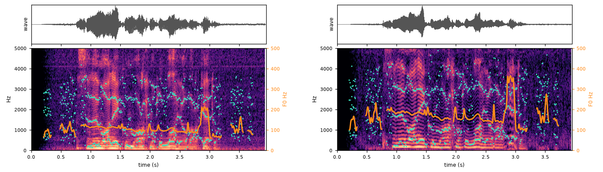
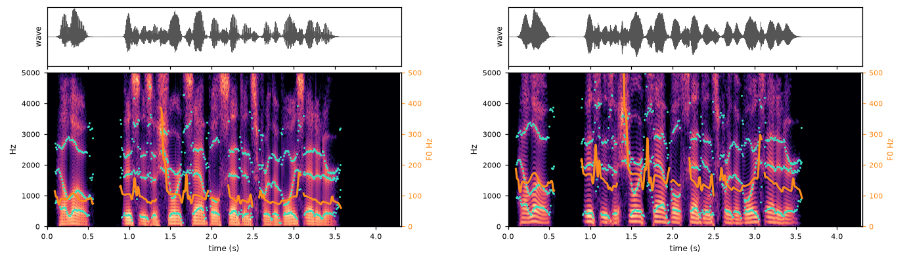
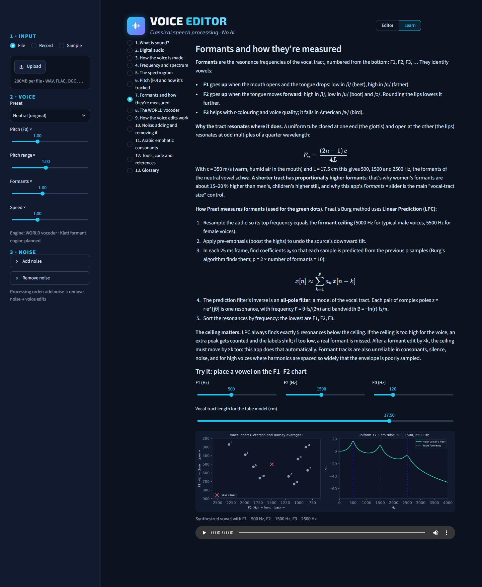
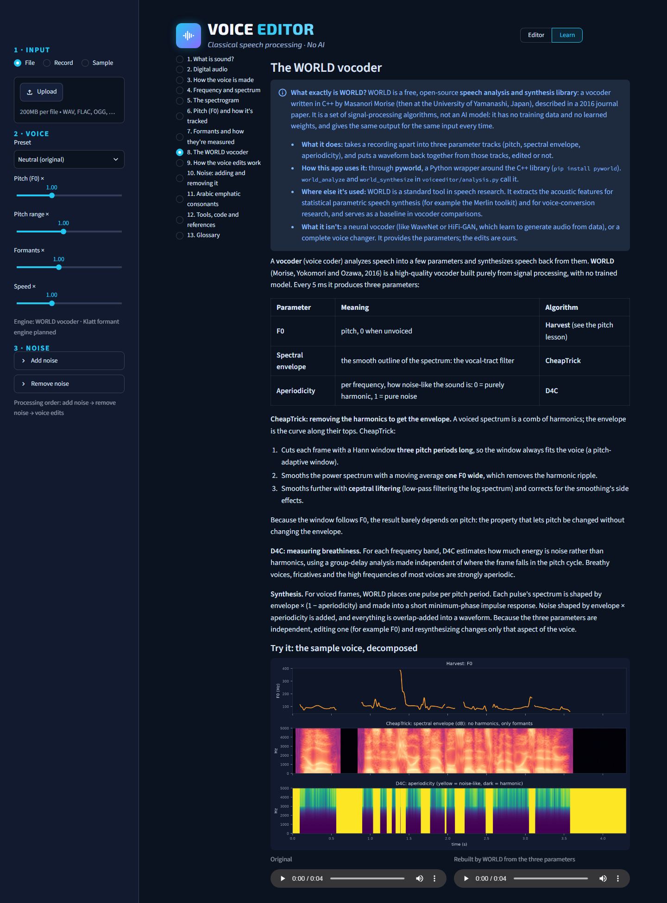

# Voice editor

A personal and teaching tool that edits speech with **classic signal processing, no AI**.
Load a file, record your voice or pick a sample, then change pitch, pitch range, formants
and speed, or add and remove background noise. See every change on waveforms and
spectrograms, click any moment to inspect it, and learn how it all works in 13 built-in
lessons ([condensed here](#learn)).

## Quick start

You need **Python 3.11 or newer** ([python.org](https://www.python.org/downloads/)) and
**Git**. Tested on Windows 11 with Python 3.13.

**1. Get the code**

```
git clone https://github.com/IbrahimSobh/voiceeditor.git
cd voiceeditor
```

**2. Create a virtual environment and install the libraries** (a few minutes the first time)

Windows:

```
py -m venv .venv
.venv\Scripts\python -m pip install -r requirements.txt
```

macOS / Linux:

```
python3 -m venv .venv
.venv/bin/python -m pip install -r requirements.txt
```

**3. Start the app**

Windows:

```
.venv\Scripts\streamlit run app.py
```

macOS / Linux:

```
.venv/bin/streamlit run app.py
```

Your browser opens at **http://localhost:8501**. The first start takes about 30 seconds
while matplotlib builds its font cache.

**4. Try it**

1. In the sidebar, under **1 · Input**, choose **Sample** (or **Record** to use your microphone).
2. Under **2 · Voice**, pick the preset **More female** and press play on the **After** panel.
3. Under **3 · Noise**, open **Add noise**, tick it, then open **Remove noise** and tick it too.
4. Click anywhere on a spectrogram to inspect that moment.
5. Switch to **Learn** (top right) for the lessons.

**Troubleshooting**

- *Changes in the code don't show up:* stop the app with Ctrl+C and start it again.
- *`pip install` fails while building `pyworld`:* your Python version has no ready-made
  package for it. Use Python 3.11–3.13, or install a C++ compiler (on Windows, the free
  "Microsoft C++ Build Tools").
- *Port 8501 is busy:* add `--server.port 8502` to the run command.

## Features

### Edit a voice


| Control | What it changes |
|---|---|
| **Preset** | stored settings: *More female*, *More male*, *Happy*, *Sad* |
| **Pitch ×** | the F0 (vocal-fold rate), every voiced frame scaled |
| **Pitch range ×** | how lively the intonation is: flattens or widens the F0 curve around its mean |
| **Formants ×** | vocal-tract size: stretches the spectral envelope along frequency |
| **Speed ×** | duration, without changing pitch |
| **Add noise** | white, pink, brown, 50 Hz or 60 Hz hum, at a chosen SNR (measured on active speech) |
| **Remove noise** | spectral subtraction or Wiener filter, with strength, spectral floor and noise-estimate controls |

Each panel shows the waveform and the spectrogram, with the **F0 curve** (orange, scale on
the right) and the **formants F1–F3** (green dots) drawn on top. Players keep true
loudness, so *Noise alone* and *Removed part* play at their real level. Panels can sit
side by side or stacked:


### What is WORLD?

**WORLD** is the engine behind every voice edit. It's a free, open-source **speech analysis
and synthesis library** (a *vocoder*) written in C++ by Masanori Morise and described in a 2016
journal paper. It's pure signal processing: no AI, no training data, and the same output for
the same input every time.

WORLD does two jobs:

1. **Analysis:** it takes a recording apart, every 5 ms, into three tracks: **F0** (pitch,
   found by its *Harvest* algorithm), the **spectral envelope** (the vocal-tract filter, found
   by *CheapTrick*) and **aperiodicity** (how noise-like each frequency is, found by *D4C*).
2. **Synthesis:** it builds a waveform back from those three tracks.

This app changes the tracks in between (for example, F0 × 1.6 and the envelope stretched by
×1.17) and lets WORLD rebuild the voice. It's used through **pyworld**, a Python wrapper.
WORLD is widely used in speech research, for example to extract features for statistical
parametric speech synthesis. It isn't a neural vocoder like WaveNet or HiFi-GAN, which learn to
generate audio from data.

### Inspect any moment

The plots aren't just pictures: **click any point** of a waveform or spectrogram and a window
opens describing that exact moment in every panel (Original, With added noise, After).

- **Where you clicked.** The time, and on a spectrogram also the frequency. A white crosshair
  marks the spot on every panel. After closing the window, **Inspect** reopens it and **Clear**
  removes the marker.
- **The numbers table**, one row per panel:
  - *Amplitude*: the waveform's value at that instant (−1 to 1).
  - *Level at clicked Hz*: how strong that frequency is there, in dB. Compare rows to see how
    much noise was added or removed at that frequency.
  - *F0*: the pitch at that instant, or "unvoiced" for consonants like /s/ and for silence.
  - *F1, F2, F3*: the first three formants, measured by Praat.
- **The spectrum at that moment**, one small chart per panel, from a 40 ms slice of sound:
  - the coloured line is the actual spectrum: its regular peaks are the **harmonics** of F0;
  - the white line is WORLD's **spectral envelope**: the smooth vocal-tract curve along the
    harmonic tops;
  - green dotted lines mark the **formants**, and a red line marks the clicked frequency.

  Comparing Original and After shows each edit directly: a pitch change spaces the harmonics
  further apart, while a formant change moves the envelope's peaks.
- **Listen to 0.5 s around the click** in every panel, to connect what you see with what you hear.

When speed is changed, the same sound sits at a different time in the After panel; the window
lines them up, so every row describes the *same sound*, not the same clock time.



## Listen: before and after

Each video plays the **before** sound (playhead on the left spectrogram), a short pause, then the
**after** sound (playhead on the right). Press play; turn the sound on if the player starts muted.
Below each video are the separate WAV files. All were made by [make_examples.py](make_examples.py)
and [make_videos.py](make_videos.py) with the same code as the app.

### Arabic

A short Arabic recording of a male voice (`samples/sample_male_ar.wav`), turned female, sad and
happy.

#### Arabic: male → female (More female: F0 ×1.6, range ×1.1, formants ×1.17)

https://github.com/user-attachments/assets/5b2ff1f2-f6c6-438c-b27c-0832724b5d7f

Before: <audio controls src="docs/audio/original_male_ar.wav"></audio> [original_male_ar.wav](docs/audio/original_male_ar.wav) · After: <audio controls src="docs/audio/ar_male_to_female.wav"></audio> [ar_male_to_female.wav](docs/audio/ar_male_to_female.wav)

#### Arabic: sad (lower, flatter pitch, 18 % slower)

https://github.com/user-attachments/assets/d48a0670-665a-452a-a6b1-b4056d25b3f9

Before: <audio controls src="docs/audio/original_male_ar.wav"></audio> [original_male_ar.wav](docs/audio/original_male_ar.wav) · After: <audio controls src="docs/audio/ar_sad.wav"></audio> [ar_sad.wav](docs/audio/ar_sad.wav)

#### Arabic: happy (higher, livelier pitch, 12 % faster)

https://github.com/user-attachments/assets/5898811f-a89f-4ea2-9f28-f1e53c0341b9

Before: <audio controls src="docs/audio/original_male_ar.wav"></audio> [original_male_ar.wav](docs/audio/original_male_ar.wav) · After: <audio controls src="docs/audio/ar_happy.wav"></audio> [ar_happy.wav](docs/audio/ar_happy.wav)



### English voice edits

#### Male → female (More female: F0 ×1.6, range ×1.1, formants ×1.17)

https://github.com/user-attachments/assets/946183b7-71a9-4330-b84e-293395c8f25c

Before: <audio controls src="docs/audio/original_male.wav"></audio> [original_male.wav](docs/audio/original_male.wav) · After: <audio controls src="docs/audio/male_to_female.wav"></audio> [male_to_female.wav](docs/audio/male_to_female.wav)

#### Female → male (More male: F0 ×0.65, range ×0.9, formants ×0.88)

https://github.com/user-attachments/assets/ada8db01-467f-4bfa-b463-3139f259f220

Before: <audio controls src="docs/audio/original_female.wav"></audio> [original_female.wav](docs/audio/original_female.wav) · After: <audio controls src="docs/audio/female_to_male.wav"></audio> [female_to_male.wav](docs/audio/female_to_male.wav)

#### Happy: higher, livelier pitch, 12 % faster

https://github.com/user-attachments/assets/3ac65e9b-a7b3-41c2-9513-8f1119fe5c6e

Before: <audio controls src="docs/audio/original_female.wav"></audio> [original_female.wav](docs/audio/original_female.wav) · After: <audio controls src="docs/audio/happy.wav"></audio> [happy.wav](docs/audio/happy.wav)

#### Sad: lower, flatter pitch, 18 % slower

https://github.com/user-attachments/assets/5fe0f318-44d3-443f-8978-54070364f25b

Before: <audio controls src="docs/audio/original_female.wav"></audio> [original_female.wav](docs/audio/original_female.wav) · After: <audio controls src="docs/audio/sad.wav"></audio> [sad.wav](docs/audio/sad.wav)

#### Slower, speed ×0.75 (same pitch)

https://github.com/user-attachments/assets/64a1e36f-1296-4786-9ba5-6242aeace9ba

Before: <audio controls src="docs/audio/original_male.wav"></audio> [original_male.wav](docs/audio/original_male.wav) · After: <audio controls src="docs/audio/slower_0.75x.wav"></audio> [slower_0.75x.wav](docs/audio/slower_0.75x.wav)

#### Faster, speed ×1.5 (same pitch)

https://github.com/user-attachments/assets/7580a49b-e90d-445e-9081-db83e9b61fb2

Before: <audio controls src="docs/audio/original_male.wav"></audio> [original_male.wav](docs/audio/original_male.wav) · After: <audio controls src="docs/audio/faster_1.5x.wav"></audio> [faster_1.5x.wav](docs/audio/faster_1.5x.wav)



### Noise

#### Add white noise at 10 dB SNR

https://github.com/user-attachments/assets/6308e847-05eb-4072-9632-62196c8abea0

Before: <audio controls src="docs/audio/original_male.wav"></audio> [original_male.wav](docs/audio/original_male.wav) · After: <audio controls src="docs/audio/noisy_white_10dB.wav"></audio> [noisy_white_10dB.wav](docs/audio/noisy_white_10dB.wav)

#### Remove it: spectral subtraction

https://github.com/user-attachments/assets/94d99712-c62f-40f9-bbbd-639a7c9a44b2

Before: <audio controls src="docs/audio/noisy_white_10dB.wav"></audio> [noisy_white_10dB.wav](docs/audio/noisy_white_10dB.wav) · After: <audio controls src="docs/audio/denoised_spectral_subtraction.wav"></audio> [denoised_spectral_subtraction.wav](docs/audio/denoised_spectral_subtraction.wav)

#### Remove it: Wiener filter

https://github.com/user-attachments/assets/495a64fb-897c-4f1b-b896-9630f1cc4cf2

Before: <audio controls src="docs/audio/noisy_white_10dB.wav"></audio> [noisy_white_10dB.wav](docs/audio/noisy_white_10dB.wav) · After: <audio controls src="docs/audio/denoised_wiener.wav"></audio> [denoised_wiener.wav](docs/audio/denoised_wiener.wav)

#### Add 50 Hz mains hum at 10 dB SNR

https://github.com/user-attachments/assets/57cd0e04-64a5-457d-9678-4f942c9a3053

Before: <audio controls src="docs/audio/original_female.wav"></audio> [original_female.wav](docs/audio/original_female.wav) · After: <audio controls src="docs/audio/hum_50Hz_10dB.wav"></audio> [hum_50Hz_10dB.wav](docs/audio/hum_50Hz_10dB.wav)

#### Remove the hum: Wiener filter, strength ×1.5

https://github.com/user-attachments/assets/12cf2f87-4ca0-4f51-93ef-9114ab75ad87

Before: <audio controls src="docs/audio/hum_50Hz_10dB.wav"></audio> [hum_50Hz_10dB.wav](docs/audio/hum_50Hz_10dB.wav) · After: <audio controls src="docs/audio/hum_removed_wiener.wav"></audio> [hum_removed_wiener.wav](docs/audio/hum_removed_wiener.wav)


Listen for the trade-off: spectral subtraction removes more noise but leaves faint
"musical noise" (random beeps); the Wiener filter sounds smoother but keeps a little more
hiss.

## Learn

The app's **Learn** view (top right) has 13 lessons with interactive demos you can see and hear.
Below is a condensed version of the core lessons; the app has the full text, more detail,
the demos, Arabic emphatic consonants, the tools and references, and a glossary.

| Build a vowel from source × filter | Formants and the vowel chart | WORLD, decomposed |
|---|---|---|
|  |  |  |

<details>
<summary><b>1. What is sound?</b></summary>

Sound is a **pressure wave**: a vibrating object pushes on the air, and regions of slightly
higher and lower pressure travel outward at about 343 m/s. A microphone turns the pressure
changes into a voltage, and the computer stores it as numbers: the **waveform**. The simplest
sound is a sine wave, $x(t) = A\sin(2\pi f t)$, where **A** (amplitude) sets loudness and **f**
(frequency, in hertz) sets pitch. Human hearing covers roughly 20 Hz to 20 kHz. Loudness is
measured in **decibels**, a logarithmic scale: $L = 20\log_{10}(A/A_\text{ref})$. Doubling the
amplitude adds about 6 dB.
</details>

<details>
<summary><b>2. Digital audio</b></summary>

A computer measures the wave at regular instants. The **sample rate** is how many measurements
per second: this app uses 16,000. A sampled signal can only hold frequencies below half the
sample rate (the **Nyquist frequency**, 8 kHz here), enough for speech, whose vowel-defining
formants lie below about 4 kHz. Higher frequencies don't vanish: they fold down to false lower
frequencies (**aliasing**), so audio is filtered before resampling. **Bit depth** is the precision
of each sample: 16 bits give 65,536 levels and about 96 dB of range.
</details>

<details>
<summary><b>3. How the voice is made: the source–filter model</b></summary>

The **lungs** push air up. At the **larynx**, the **vocal folds** open and close rapidly for
*voiced* sounds (vowels, /m/, /z/), chopping the air into puffs; the number of puffs per second
is the **fundamental frequency, F0**, heard as pitch. For *unvoiced* sounds (/s/, /f/) the folds
stay apart and turbulent air makes noise. Above the larynx, the **vocal tract** (throat, mouth,
nose; about 17 cm in men, 14 cm in women) acts as a filter: it resonates and boosts some
frequencies. Those resonance peaks are the **formants**. In the frequency domain,
$S(f) = G(f)\,H(f)\,R(f)$: source × vocal-tract filter × lip radiation. Source and filter are
**independent** (you can sing many notes on one vowel), and every edit in this app relies on that.
</details>

<details>
<summary><b>4. Spectrum and spectrogram</b></summary>

Any signal is a sum of sine waves (Fourier). The **spectrum** shows how strong each frequency is.
A voiced sound contains **harmonics** at F0, 2·F0, 3·F0, …; the vocal tract changes their
strength, and the formants are where harmonics come out strongest. The **FFT** computes the
spectrum of a frame quickly; each frame is first multiplied by a smooth **window** (Hann) to
avoid false frequencies. A **spectrogram** is many short spectra side by side (the **STFT**):
time across, frequency up, level as colour. Long windows resolve harmonics (*narrowband*);
short windows show formants and each glottal pulse (*wideband*). This app uses 25 ms.
</details>

<details>
<summary><b>5. Pitch (F0) and how it's tracked</b></summary>

Typical speaking F0 is about 85–180 Hz for men and 165–255 Hz for women. Its rise and fall over
a phrase is **intonation**. The classic way to find F0 is **autocorrelation**: compare a frame
with a copy of itself shifted by a lag τ; the strongest match within 60–500 Hz is at τ = one
period, so F0 = sample rate / τ. WORLD's **Harvest** algorithm is more robust: it filters the
signal with band-pass filters tuned to candidate F0s, measures each output's period from its
zero crossings and peaks, keeps candidates that agree, and joins them into a smooth contour.
</details>

<details>
<summary><b>6. Formants and how they're measured</b></summary>

**F1** rises as the mouth opens (low in /i/ "beet", high in /ɑ/ "father"); **F2** rises as the
tongue moves forward (high in /i/, low in /u/ "boot"). A uniform tube closed at the glottis
resonates at $F_n = (2n-1)c/4L$: for L = 17.5 cm that's 500, 1500 and 2500 Hz. **A shorter tract
means proportionally higher formants**, which is why women's formants are about 15–20 % higher
than men's. Praat measures formants with **linear prediction (LPC)**: it predicts each sample
from the previous ones, which yields an all-pole model of the vocal tract whose resonances are
the formants. The search needs a **formant ceiling** (5000 Hz for low voices, 5500 Hz for high
ones) that must move with any formant edit.
</details>

<details>
<summary><b>7. WORLD, step by step</b></summary>

See [What is WORLD?](#what-is-world) above. Its three analysis algorithms:

- **Harvest** finds F0 (lesson 5).
- **CheapTrick** finds the spectral envelope: it cuts each frame with a window three pitch
  periods long, averages the power spectrum over one F0 width to remove the harmonic ripple,
  and smooths the result in the cepstral domain. Because the window follows the pitch, the
  envelope barely depends on F0, so pitch can change without changing the envelope.
- **D4C** measures aperiodicity: for each frequency band, the share of energy that is noise
  rather than harmonics (0 = harmonic, 1 = noise).

**Synthesis** places one pulse per pitch period shaped by envelope × (1 − aperiodicity), adds
noise shaped by envelope × aperiodicity, and overlap-adds the pieces into a waveform.
</details>

<details>
<summary><b>8. How the edits work</b></summary>

- **Pitch ×k** multiplies every voiced F0 value by k (×2 is an octave).
- **Pitch range ×r** stretches intonation around the mean, in the log domain:
  $\log F_0' = \mu + r(\log F_0 - \mu) + \log k$. Below 1 sounds flat; above 1, lively.
- **Formants ×α** stretches the envelope along frequency, $S'(f) = S(f/\alpha)$, imitating a
  shorter or longer vocal tract.
- **Speed ×s** resamples the 5 ms frames in time; F0 values are kept, so pitch doesn't change.

Raising pitch alone sounds like a man speaking high; speeding up a recording raises pitch *and*
formants together, the "chipmunk" sound. A convincing male → female change moves each by its
own factor: F0 ×1.6 and formants ×1.17. *Happy* and *Sad* follow emotion research (happy:
higher, livelier, faster; sad: lower, flatter, slower), but real emotion also changes loudness,
voice quality and timing, so expect a hint of the emotion, not an actor.
</details>

<details>
<summary><b>9. Noise: adding and removing it</b></summary>

**SNR** (signal-to-noise ratio) compares speech power with noise power: $\text{SNR} = 10\log_{10}(P_s/P_n)$ dB.
20 dB is mildly noisy, 5 dB clearly noisy, 0 dB means equal power. White noise has equal power at
all frequencies, pink falls 3 dB per octave, brown 6 dB per octave, and hum is 50 or 60 Hz mains
buzz with its harmonics. Removal works on the STFT: the quietest 10 % of frames give the noise
spectrum N, then every frequency of every frame gets a gain between 0 and 1.
**Spectral subtraction** removes the noise magnitude, $|\hat S| = |X| - \alpha|N|$; the **Wiener
filter** uses the gain $\xi/(1+\xi)$, where ξ estimates the clean-speech SNR. A **spectral floor**
keeps a little of every frequency to limit **musical noise**, the random beeps left behind.
Both assume steady noise, and both damage some speech: removing more noise always costs more speech.
</details>

## Settings in the web address

Settings can also be given in the address, which is handy for demos, for example:

- `http://localhost:8501/?sample=sample_male_en.wav&preset=More+female&add=White&snr=15&remove=Wiener+filter`
- `http://localhost:8501/?sample=sample_male_en.wav&click=1.62,1200` (opens the inspection window)
- `http://localhost:8501/?view=learn&lesson=7`

Parameters: `sample`, `preset`, `add` (noise type), `snr`, `remove` (method), `click`
(time in s, frequency in Hz), `layout=stacked`, `view=learn`, `lesson` (1–13).

## Checks and regenerating the docs

```
.venv\Scripts\python check_pipeline.py
```

Measures that each edit and noise tool does what it claims (pitch ratio, range ratio,
formant shift, duration, SNR accuracy, noise removal, click-to-data accuracy).

```
.venv\Scripts\python make_examples.py
```

Rebuilds `docs/audio` and the example spectrogram pictures. Then `make_videos.py` rebuilds `docs/video`
(it needs ffmpeg: `.venv\Scripts\python -m pip install imageio-ffmpeg`);
GitHub only plays videos uploaded through its web editor, so new videos must be re-uploaded
(drag them into any comment box on GitHub, copy the `user-attachments` links into this README).

```
.venv\Scripts\streamlit run app.py --server.port 8503
.venv\Scripts\python make_screenshots.py 8503
```

Rebuilds the screenshots in `docs/img` with a headless Chrome or Edge (a throwaway
profile, not yours). Then `.venv\Scripts\python make_banner.py` rebuilds the banner from them.

## How it works

Processing order: input → add noise → remove noise → voice edits. When no voice edit is
active, WORLD is skipped, so the noise result is heard exactly.

| Step | Tool | File |
|---|---|---|
| Load, mono, resample to 16 kHz | soundfile, scipy | `voiceeditor/audio_io.py` |
| Add noise at a chosen SNR | numpy | `voiceeditor/noise.py` |
| Remove noise (spectral subtraction or Wiener filter) | scipy STFT | `voiceeditor/noise.py` |
| Split speech into F0, spectral envelope, aperiodicity, and rebuild it | WORLD via pyworld ([what is WORLD?](#what-is-world)) | `voiceeditor/analysis.py` |
| Formant tracks F1–F3 for display | Praat (parselmouth) | `voiceeditor/analysis.py` |
| Edits and presets | numpy | `voiceeditor/edits.py` |
| Plots, click-to-data conversion | matplotlib | `voiceeditor/plots.py` |
| Clickable images | streamlit-image-coordinates | `app.py` |
| User interface | Streamlit | `app.py` |
| Lessons and their demos | Streamlit, matplotlib | `voiceeditor/lessons.py` |

The Learn view explains every step in detail.

## Roadmap

- Version 2: Klatt formant engine, with a view comparing the same edit through WORLD and Klatt.
- Later: loudness and brightness controls for emotion.

The `samples` folder holds two English sentences made with Windows' built-in voices
(Microsoft David and Zira) and a short Arabic recording of a male voice.
